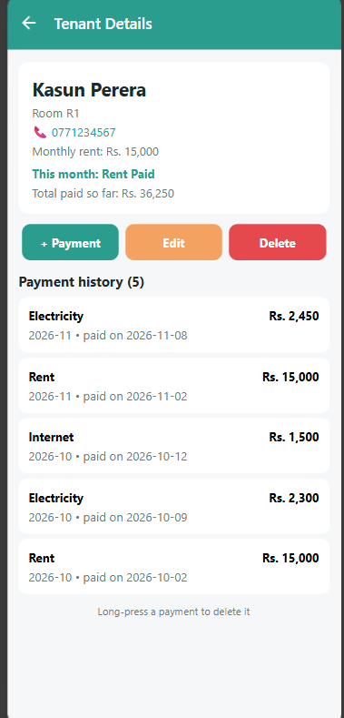
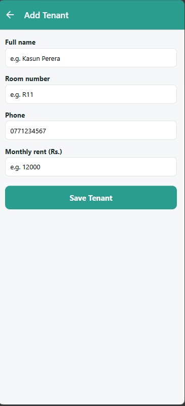
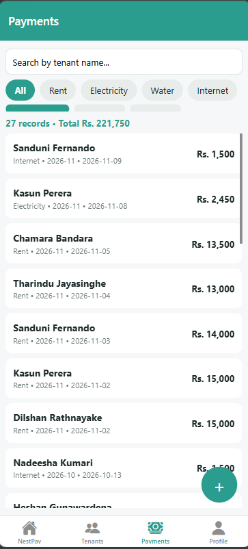
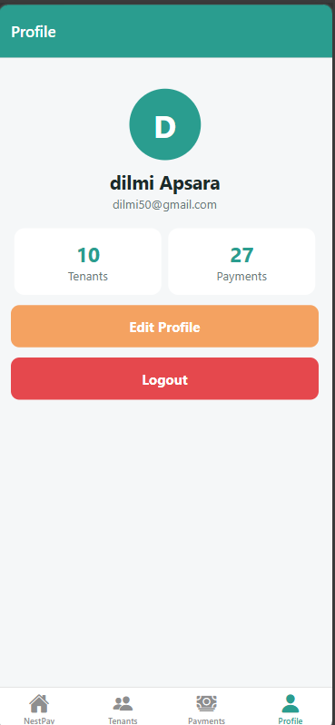

# 🏠 NestPay – Boarding House Rent & Utility Tracker

## 📌 Project Overview
NestPay is an offline React Native (Expo) mobile app that helps boarding house
owners manage tenants, monthly rent and utility bills (electricity, water,
internet). All data is stored locally on the device using AsyncStorage, so the
app works without an internet connection. No public APIs or online databases are used.

**Objective:** Replace paper records with a simple app to track who has paid,
who is pending, and how much has been collected each month.

## ✨ Key Features
- Register, login and logout with a saved local session
- Dashboard with monthly summary, collections by type and pending rent list
- Tenants list with search (name / room) and Paid / Pending filter
- Tenant details with contact info and full payment history
- Add, edit and delete tenants
- Payments list with search, type filter and month filter
- Add payment records (Rent, Electricity, Water, Internet)
- Profile screen with edit details and logout
- Pre-loaded local dataset (10 tenants, 27 payments)
- Fully offline

## 📱 Screenshots
<p align="center">
  
  
  
</p>
<p align="center">
  
  
  
</p>
<p align="center">
  
  
  
</p>

## 🛠 Technologies Used
- React Native (Expo SDK 58)
- React Navigation (native stack + bottom tabs)
- AsyncStorage (local storage)
- @expo/vector-icons
- JavaScript (ES6), Git & GitHub

## 📂 Project Structure
```
NestPay/
├── App.js
├── screenshots/
└── src/
    ├── components/   Chip.js
    ├── data/         seedData.js
    ├── navigation/   AppNavigator.js
    ├── screens/      Login, Register, Dashboard, Tenants,
    │                 TenantDetail, AddTenant, Payments,
    │                 AddPayment, Profile
    ├── storage/      storage.js, authStorage.js
    └── theme.js
```

## ⚙️ Installation and Setup
1. Install Node.js (LTS) and the **Expo Go** app on your phone.
2. Clone and install:
   ```bash
   git clone https://github.com/2022ict38/NestPay.git
   cd NestPay
   npm install
   ```
3. Start the app:
   ```bash
   npx expo start
   ```
4. Scan the QR code with Expo Go.

## 🌟 Special Features
- Rent status (Paid / Pending) is calculated automatically from payment records
- Seed data is saved to AsyncStorage on first launch
- Data persists after the app is closed
- Branch-based development (`feature/register`, `feature/login`, `feature/profile`)

## 👤 Author
M.G.D.Apsara
2022/ict/38
IT3133 